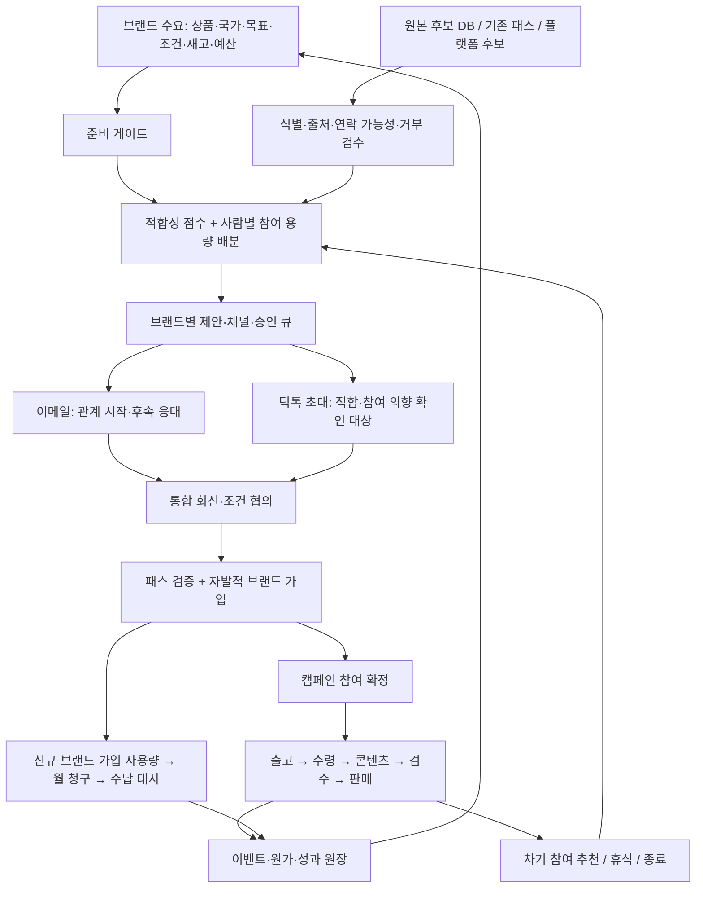

# Theprlist 회사 운영·서비스 설계 v2

2026-10-12. 로컬 e1eeeed를 기준으로 검수·개발. 원격 최신 여부, 실제 운영 설정·계약·청구는 확인되지 않았다. 외부 연락·운영 배포·실데이터 반입 없음.

## 1. 회사가 파는 가치와 유지할 자산

회사는 브랜드가 적합한 크리에이터를 확보하고 반복 협업을 운영하도록 돕는다. Theprlist는 이를 브랜드별 셀과 크리에이터 패스로 서비스화한다. 발굴 비용을 공유하되, 각 브랜드의 가입·계약·성과·비공개 정보는 분리한다.

**현재 코드의 중심 BM은 브랜드별 신규 검증 가입 1건당 5,000원(부가세 포함), 월 합산 청구다.** 근거: `db/migrations/010_signup_billing.sql`, `020_signup_price_5000.sql`, `022`, `024`, `services/api/api/routes_billing.py`. 같은 브랜드의 기존 가입자는 재참여만으로 다시 과금하지 않는다. 가격·과금 코드는 이번에 변경하지 않았다. 실제 고객 계약과 운영 가격은 대조가 필요하다.

유지: 패스(크리에이터), 셀(브랜드 멤버십), 아리(운영 보조), 캠페인, 승인 게이트, 가입 검증·사용량·월 청구. 메일 발송량을 판매 가치나 청구 근거로 치환하지 않는다. 운영대행료·성과 수수료·콘텐츠 사용권료·구독제는 추가 BM 가설이며 확정 상품으로 표기하지 않는다.

**OSMU는 세 가지를 나눈다.** 관계 재사용은 관심·국가·부하와 다음 브랜드 참여 의사를 확인한다. 성과 학습은 허용된 공통 특성만 활용하고 고객 비공개 데이터를 타 브랜드에 노출하지 않는다. 콘텐츠 재사용은 매체·기간·지역·유료광고·편집·브랜드 사용권을 별도로 확인한다. A 브랜드 가입은 B 브랜드 가입 또는 콘텐츠 사용 동의가 아니다.

## 2. 구조도

화면 형태: 회사 통합 수요·공급 보드 → 브랜드별 작업함 → 사람별 관계 타임라인 → 예외 큐 → 물류·콘텐츠 보드 → 손익·청구 보드. 회사 화면과 고객 화면은 같은 데이터 모델을 사용하되 tenant 권한으로 분리한다. 이번 `tools/operations-review/index.html`은 이 구조와 판단을 위한 오프라인 검토실이며 운영 CRM 전체 구현은 아니다.

## 3. 채널과 발신 구조

이메일은 적합 대상의 모집·관계 관리, 틱톡 초대는 상품 참여 연결, Theprlist는 신원·브랜드 관계·운영 이력의 중심으로 둔다. 이메일 개인화는 이름 바꾸기가 아니라 해당 인물의 검증된 카테고리·콘텐츠 형태·거주국·협업 선호와 상품 조건의 일치다. 가격·효능·보상을 만들어내지 않는다.

발신 계정은 회사/브랜드 소유, 명확한 용도·국가·담당·권한으로 등록한다. 큐를 계정별·브랜드별로 제어하고 동일 인물의 중복 접촉을 회사 차원에서 조정한다. 제공자 정책과 반송·불만·거부에 따라 중단하며, 차단 우회를 위한 도메인/계정 회전은 설계하지 않는다. 답장은 발신 계정에 흩어두지 않고 담당·기한·다음 행동으로 관리한다.

Theprlist의 브랜드당 Gmail 1계정 연결과 일별 소량 제한은 현재 코드 제약이다. 여러 계정 구성은 별도 신규 개발이다. Glovek은 도메인·메일박스·발송 준비와 운영자 소유 시드 전송 기반이며, 일반 크리에이터 CRM이나 Theprlist 전송 어댑터가 아니다. 시드 제한은 유지한다. 새 어댑터에는 동일 거부 목록·멱등키·명확한 전송 결과·회신 귀속·킬 스위치가 필요하다.

## 4. 6개 전략 가설과 평가

아래 수치는 성과 예측이 아니라 비교 실험의 설계다. 같은 국가·상품·보상 조건 안에서 무작위 배정하고 creator 단위로 교차 노출을 막는다. 표본수는 기준 전환율 확인 뒤 결정한다. 20~50명은 흐름 검증용이며 유의미한 승자 선언용이 아니다.

| 가설 | 실행 형태 | 1차 평가 | 실패·중단 신호 | 우선순위 |
|---|---|---|---|---|
| H1 적합성 선별이 문구 미세변경보다 중요 | 카테고리·국가·이행 이력으로 선별 vs 기존 방식 | 접촉 고유 대비 참여 확정·게시, 확정당 총원가 | 국가 부적합, 유료 선호 불일치 지속 | 1 |
| H2 조건 투명한 이메일이 쓸모있는 회신을 만든다 | 선정 이유·보상·해야 할 일·단일 다음 행동, USP 유/무 비교 | 유효 관심→가입→확정, 담당 처리시간 | 답장 증가에도 가입·확정 없음 | 1 |
| H3 한 브랜드 참여 후 적합한 다음 제안이 수익성을 높인다 | 다음 브랜드 추천 수락 vs 미추천 비교 | 30/60일 재참여 고유, 추가 브랜드 신규 가입, 추가 기여이익 | 피로·거부·동시 협업 과부하 | 2 |
| H4 이메일+선별 틱톡 초대가 초대권 효율을 높인다 | 의향 확인 대상 우선 초대 vs 적합 후보 직접 초대 | 초대 1건당 확정·게시, 소요일 | 관심 단계 지연으로 최종 전환 감소 | 2 |
| H5 무료 시딩·커미션·유료 제작을 분리하면 전환이 개선된다 | 협업 선호별 조건, 승인 예산 안에서 비교 | 게시당 비용·판매 기여·재참여 | 약속한 조건과 실제 정산 불일치 | 2 |
| H6 성공 콘텐츠의 사용권 기반 재활용이 추가 이익을 만든다 | 허용된 소재를 매체별 재편집·테스트 | 추가 비용 대비 증분 기여이익 | 사용권 부족, 주장 검수 실패, 증분효과 없음 | 3 |

선택: H1+H2를 먼저 검증하고, 실제 참여자에서 H3를 시작한다. H4는 초대권과 관심 확인 소요시간의 교환을 비교한다. 가입 과금만 늘리고 미활동 멤버를 쌓는 최적화는 브랜드 갱신·크리에이터 이탈에 불리하므로 게시·판매·유지율을 함께 본다.

## 5. 데이터 계약과 집계

- `creator_id`: 전사 고유 사람. 플랫폼+정규화 UID/handle은 식별 증거이며 이메일만으로 사람을 합치지 않는다. 중복·병합은 검토 이력과 취소 경로를 둔다.
- `contact_id`: 연락수단. 원문 보존, 정규화값 분리. 한 사람 여러 이메일/여러 사람 공유 이메일 가능. Gmail 별칭 임의 병합 금지.
- `brand_id`, `campaign_id`, `product_id`: 고객·캠페인·상품 분리. 기존 memberships의 brand+creator 관계를 활용하고 캠페인 참가 관계를 별도 관리한다.
- `event_id`, `source`, `source_ref`, `occurred_at`, `recorded_at`, `actor`, `idempotency_key`: 사건과 관측 시각 구분. 모르는 날짜는 NULL. 추정치·운영자 보고·플랫폼 확인을 구분한다.
- 제안에는 sender/contact/campaign/template/version/offer/consent-or-contact-basis가 연결된다. 콘텐츠에는 URL·주장 검수·사용권, 주문에는 플랫폼 주문 ID·통화·반품·귀속 규칙이 연결된다.
- 거부는 전사 연락 금지와 브랜드 한정 거부를 분리하되, 전사 금지가 우선한다. 권한 불명·출처 불명 연락처는 보류한다.

주·월 집계는 Asia/Seoul 시간대의 시작 포함/종료 제외로 고정하는 안을 권고한다. 발송 시도, 제공자 접수, 배달 확인, 회신, 신청, 참여 확정, 출고, 수령, 게시, 주문 발생을 각각 표시한다. 이메일 배달과 샘플 수령은 별도 이벤트다. 한 사람이 A/B 캠페인에 참여하면 참가 관계 2건, 전체 고유 1명이다. 1주차와 2주차에 동일인이 있으면 주간 고유 합계는 월간 고유가 아니다.

권고 운영 KPI는 **해당 월에 참여 확정 이상의 근거 있는 활동이 발생한 고유 인원**으로 두고, 월초 활성 잔여 인원·신규 확정·실제 게시 고유를 병기한다. 최종 인정 단계는 대표 결정 전 확정값으로 적용하지 않는다. 월 3만 명을 가입 과금 건수나 과거 풀 크기로 대체하지 않는다.

이번 추가 `dispatch_import_events`는 CSV 상태 증빙·재반입 방지를 위한 좁은 원장이다. 전사 creator 이벤트 원장, 메시지·주문 수집, 월 고유 실적 대시보드는 다음 개발 범위다. CSV 증빙은 운영자 보고이며 외부 플랫폼 확인으로 승격하지 않는다. 이전 INVITED 데이터는 승인 시 생성됐을 수 있으므로 근거 없이 실제 초대로 이관하지 않는다.

## 6. 브랜드별 연결

| 브랜드 | 현재 근거 | 먼저 연결할 내용 | 통과 기준 |
|---|---|---|---|
| RETURNU US | 신청17·발송2, 목표30 | 17명의 creator/캠페인/경로, 두 배송의 추적·수령, 10/14와10/30 의미 | 17명 중 단계·담당·다음 행동 식별, 공백 별도 표시 |
| FAU US | 목표100/120 충돌, 신청3, 발송체크0 | 계약 목표, 100+20 구분, 브러시/재고/가이드, 보상15% | 계약·물류·가이드 확정 후 모집 준비 |
| Meltin US | 목표30, 신청2·취소1 범위 불명 | 유효 신청/취소/확정, 10/16 납기와 현 물류 | 기한 내 가능한 확정 수와 예외 목록 |
| Exomera US | 월20·누적60, 승인1, 별도500배치 신청0 | 월 목표와 누적 분리, 배치ID와 승인 경로 | 같은 분모로 재구성, 경로 미상은 미상 유지 |
| Berris VN/TH | 목표30+30, 풀650/117 | 국가별 신청 풀↔이번 캠페인 선발, 입고·가이드 | 풀을 확정 실적으로 세지 않음 |
| 고려공작/웰더마/JMW | 준비·계약 범위 미확인 | 상품 링크·재고·월/전체 수량·LIVE 계약 | 준비 게이트 전 모집 큐 제외 |

자료 기준은 10/6 회의,10/7 시트,10/8 보고다. 오늘 실적 아님. 원문: [회의](https://app.notion.com/p/3f1193cdf1338080959cc22c7fb91364), [10/8 이메일](https://dino-hq.slack.com/archives/C0ABQHYS4KA/p1791439852699549), [통합 관리](https://docs.google.com/spreadsheets/d/1DFh3walHS9t1Ugtzo46_yBdee4nDQ64cl7Re6LqCmBA/edit). 인계된 내용이며 이번에 전체 원문을 재수집하지 않았다. 비밀번호 열은 분석 대상에서 제외한다.

## 7. 용량·손익 모델

월 목표30,000에서 유지/재활성9,000이면 신규21,000이 필요하다. 접촉→인정단계 전환5% 가정이면 신규 적합 고유420,000명이다. 이는120,525개의 이메일 기입 행보다 크며, 그 행도 연락 가능한 고유 사람이 아니다. 동일 대상 재발송을 새 공급으로 더할 수 없다. 해결 변수는 전환 개선, 유지·재참여, 신규 적합 공급, 상품·조건, 처리 용량이다.

회사 수익: 신규 검증 브랜드 가입 청구액 − VAT − 환불/공제 − 회사 부담 모집·운영·물류·콘텐츠 원가. 현금 수납은 별도다. A 가입자에게 B를 추천해도 B 가입 검증 전 매출이 아니다. B 추가 가입이 성립하면 추가수익에서 B의 증분원가를 뺀다. A의 최초 확보비를 비용 장부에서 두 번 공제하지 않는다. 공통원가는 일관된 배부 기준을 둔다.

검토실 계산기는 시나리오일 뿐 실적 예측이 아니다. 원본 통화와 환율일이 없는 GMV는 국가 간 합산하지 않는다. 현재 legacy GMV 필드의 통화/반품 대사는 미완성이므로 정산 근거로 사용하지 않는다.

## 8. 파트별 개발·마일스톤

| 단계 | 실제 산출물 | 완료·확대 기준 | 제안 책임 |
|---|---|---|---|
| M0 이번 6시간 | 격리 작업본·기준 태그·READY/증빙 수정·검토실·QA·가이드 | 테스트 통과·외부 전송0·미구현 명시 | 개발/대표 검토 |
| M1 검토 후 1~2작업일 가정 | 첫 브랜드 조건표, 식별·이벤트 계약, 예외 큐 설계, 수요 수량 확정 | 계약·재고·조건·담당·접촉 근거 완비 | 이성경 연결, 브랜드/물류 확인 |
| M2 다음 개발 단위 | 전사 creator/contact 매핑, 거부 통합, 출처별 staging·dry-run·정정 | 중복·충돌·삭제/복원·브랜드 격리 테스트 | 데이터/개발 |
| M3 다음 개발 단위 | 통합 회신·다음 행동·SLA, 메시지/캠페인 귀속, 다계정 큐 설계 | 중복발송 방지·결과불명 중지·거부 즉시 차단·담당 부하 | 개발/실무 |
| M4 승인된 첫 운영 실험 | 1브랜드·1국가, 20~50명 전체 흐름 검증안 | 가입→확정→수령→게시 실제 연결, 미확인 원가 없음 | 실무/물류/콘텐츠 |
| M5 검증 후 | 다브랜드 OSMU·정식 전송 어댑터·사용권·주문 귀속 | 추가 브랜드 증분이익·거부/피로 관리·재현 가능한 전환 | 개발/재무 |
| M6 규모 확대 | 고유100→1,000→5,000→30,000의 용량 계획 | 각 구간 공급·응대·물류·검수·현금흐름 충족 | 대표/운영 |

M1 이후 기간은 가정이며 완료 약속이 아니다. 모집→배송→게시 리드타임 때문에 오늘 3만 명을 검증할 수 없다. M4도 현 요청에서는 외부 연락을 실행하지 않는다. 숫자 구간 자체가 확대 허가가 아니며 다음 구간에 필요한 실제 처리 용량과 원가를 통과해야 한다.

## 9. 외부 고객에게 판매하기 위한 추가 요구

고객 온보딩에는 브랜드 소유권·목표·상품·가격·가입 과금 설명·동의/증빙을 둔다. 청구 화면에는 신규 검증 가입 목록과 제외·환불 근거, 월 금액, 수납 상태를 연결한다. tenant별 읽기/쓰기/내보내기/삭제 권한과 감사 이력, 사용량 한도, 고객 지원·장애 절차, 데이터 반환, 운영자 대리접근 이력은 서비스 출시 게이트다. 고객에게 관측되지 않은 회신·게시·판매를 성공으로 보여주지 않는다.

## 10. 아직 확정하지 않은 결정

월3만 인정 단계, 첫 브랜드·국가, 실제 계약상5천원 모델 유지 여부, 회사 부담 예산/샘플비, 크리에이터 관계/콘텐츠 재사용 권한, 운영 반입·배포 범위. 이것들은 검토실에 기록할 수 있으며 저장만으로 실행되지는 않는다.
