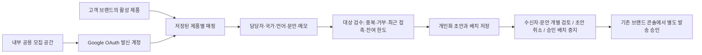

# 디노 공용 모집 어드민 · 제품별 관리

개발 화면: 어드민 `/recruitment`. 운영 배포 전 개발본입니다. 외부 발송은 수행하지 않았습니다.

## 사용하는 순서

1. 어드민 → 디노 공용 모집 → 내부 공간 생성. 고객 가입 과금은 제외합니다.
2. 회사 발신 계정은 브랜드 콘솔에서 공용 공간을 선택하고 OAuth로 연결합니다. 비밀번호는 이 기능에 저장하지 않습니다.
3. 고객 브랜드의 제품을 먼저 등록합니다. 데모·QA·내부 브랜드 제품은 고객 제품 선택에 포함하지 않습니다.
4. 새 매핑에서 브랜드·제품·발신 계정·담당자·국가·언어·제안·메모를 저장합니다. 계정이 없어도 준비 상태로 저장할 수 있습니다.
5. 발신자와 문안이 준비되면 활성 상태로 저장합니다. 이름·선정 이유·브랜드·제품 필드로 개인화합니다.
6. 헤더 없이 이메일 / 이름 / 선정 이유 세 열을 탭으로 붙여넣고 미리봅니다. 최대 10,000행의 검수 용량이며 일일 발송 허용량이 아닙니다.
7. 미리본 대상을 초안으로 저장합니다. 200개 이하 배치로 나뉘며 실제 발송은 실행하지 않습니다.
8. 매핑별 과거 배치와 수신자 상태·개별 문안을 봅니다. 초안은 개별 취소할 수 있고 승인 배치는 개별 중지할 수 있습니다. 재개·발송 승인은 이 화면에 넣지 않았습니다.

## 데이터와 운영 경계

- `recruitment_mappings`는 영구 저장됩니다. 버전 번호가 달라지면 덮어쓰기와 오래된 검수 결과 저장을 차단합니다.
- 매핑 수정은 과거 초안의 브랜드·제품명·발신자·개인 문안에 소급 적용하지 않습니다.
- ‘새 초안 중지’·보관은 새로운 초안 생성만 차단합니다. 이미 승인된 배치는 별도로 중지해야 합니다.
- 매핑의 국가·언어는 운영자가 정한 대상 조건입니다. 붙여넣은 이메일만으로 거주 국가를 검증한 것으로 취급하지 않습니다.
- 배치 숫자는 수신 주소와 전송 상태입니다. 발송 성공을 배달·회신·신청·참여 확정·배송·게시·판매로 계산하지 않으며 고유 실인원 집계도 아닙니다.
- 같은 이메일이 다른 제품에서 반복되는 관계 활용은 기존 90일 접촉·수신거부 규칙을 그대로 적용합니다.
- 기존 Gmail 한도·멱등 저장·불확실 결과 재전송 금지·발송 승인 분리를 재사용합니다.
- 담당자 필드는 업무 담당 표시이며 새 접근 권한 부여가 아닙니다. 이 기능은 관리자 JWT만 사용합니다.

## 검수

API/결제 전체 298개, 기존 UI 53개 통과. 어드민 TypeScript 및 Vite 빌드 통과.

로컬 합성 DB와 테스트 전용 계정으로 화면에서 매핑 생성 → 중복 2행 중 1개 제외 → 개인화 검수 → 초안 1개 저장 → 수신자 확인 → 초안 취소 → 새로고침 후 보존을 확인했습니다. 실제 연락처·운영 자격증명·외부 메일 전송은 사용하지 않았습니다.

검수 관점: 운영자(반복 매핑·수정), 고객 브랜드(브랜드와 제품 소속), 크리에이터(중복·거부와 정확한 개인 문안), 보안 관리자(JWT·OAuth 정보 최소화), 대표/재무(내부 과금 분리·실인원과 발송 수 구분).

## 배포와 복구

- 변경 전 태그 `recruitment-admin-base-20261015`는 `699b35e`입니다.
- 042 마이그레이션은 신규 관리 테이블을 추가합니다. 기존 데이터와 승인 큐는 변경하지 않습니다.
- 운영 배포 전 기존 문서의 DB 백업·복원 검수·현재 배포 SHA·환경 설정 보관 절차가 필요합니다. 로컬 테스트 통과가 운영 반영을 의미하지 않습니다.
- 이전 코드로 복귀할 때 신규 테이블은 보존합니다. 모집 이력을 삭제하거나 운영 DB를 DROP하지 않습니다.
# 관리자 설정 보완 — 9e7a6ed

공용 모집 화면에서 운영 브랜드·제품을 등록할 수 있다. 고객 로그인 계정·계약·결제를 만들지 않는다. 브랜드 주소·제품 이름 중복은 재사용하고, 기존 이름·커미션·상태 충돌은 덮어쓰지 않고 중단한다. 출처 메모를 원장과 제품 프로필에 기록하며 자동으로 조건 확정 표시하지 않는다.

Gmail 연결 주소 준비 → Google에서 발신 계정 선택·연결 승인 → 새로고침 순서다. 관리자 JWT로 기존 OAuth 시작 API를 사용한다. 비밀번호 저장이나 별도 브랜드 콘솔 로그인은 필요하지 않다. Google 동의는 계정 소유자가 직접 수행한다.

RETURNU·FAU 초기 설정은 10/7 시딩 자료의 제품명·커미션 20%/15%를 참조하되 최신 조건·일정·물류는 미확정 메모와 준비 매핑으로 보존한다. 발신자 미연결 상태에서는 활성화·초안 생성이 차단된다.
