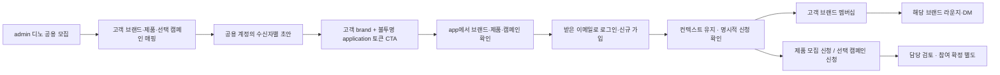

# 공용 모집 → 고객 브랜드 신청 연동 · 2026-10-16

현재 결과는 **개발·격리 DB 자동 검증 완료 / 운영 배포 및 로그인 화면 QA 미완료**다. 외부 메일·실제 연락처 반입·운영 DB 변경·자동 발송 재개를 수행하지 않았다.

## 확인한 운영 기준선

- 10/16 복원된 운영 콘솔의 공개 `engine-live.js`를 다시 받아 복원본과 바이트 일치를 확인했다. SHA-256 `30d679d464aef736b69486a68a588fa9c63e63f84cb87779280ad7e38a641063`.
- 최신 작업 체크아웃은 `codex/operations-review-20261012`, 작업 전 `848e086`. 원본 대화의 오래된 `e1eeeed`를 배포 기준으로 사용하지 않았다.
- 복원된 콘솔의 브랜드 렌더 블록을 현재 공통 소스에 반영했다. 변경 후에도 복원본의 해당 블록과 바이트 동일하다. 크림색 디자인·메일 화면 구성과 기존 발신 계정/제안 브랜드/bulk mapping/배치 함수를 보존했다.
- 앞선 운영 조회에서 실제 FAU(`fau`)·RETURNU(`returnu`) 브랜드·제품·준비 매핑이 확인됐다. 이 개발 작업에서는 두 브랜드의 기존 조건·계약·콘텐츠를 덮어쓰지 않았다.

## 실제 흐름과 식별자

| 구분 | 저장·권한 기준 | 다른 용도로 사용하지 않는 값 |
|---|---|---|
| 운영 주체 | `outreach_batches.brand_id` = 디노 공용 공간 | 고객 멤버십/신청/청구의 브랜드로 사용하지 않음 |
| 고객 | `target_brand_id` | 발신 Gmail 소유 공간과 구분 |
| 상품 | `product_id` + 생성 당시 제품명 | 다른 브랜드 제품 불가 |
| 캠페인 | 선택 `campaign_id` | 같은 고객 브랜드·같은 product_id·모집 중인 캠페인만 |
| 발신 | 배치의 `gmail_account_id` | 다계정은 기존 계정 한도·중지·중복 규칙 유지 |
| 제안/배치 | `mapping_key` / `batch_id` | 이 작업에서 별도 제안 코드·버전 제품을 완성한 것은 아님 |
| 수신자 | `recipient_id` → 불투명 링크의 해시 | 주소 원문·계정 자격증명을 URL에 넣지 않음 |
| 신청 | `recruitment_applications` | 멤버십·캠페인 선정·검증 가입 청구와 별도 |

기존 링크는 고객 브랜드만 유지했다. 신규 초안은 서버가 수신자별 링크를 만들어 제품·캠페인·배치·발신자를 역추적할 수 있게 했다. 기존 배치의 링크·메일은 소급 수정하지 않는다.

## 구현

- 043: 매핑/배치의 캠페인 연결, 신청 링크 해시·만료, 모집 신청 원장 추가. 기존 테이블/이력 삭제 없음.
- 공용 공간 자신을 대상으로 한 신규 제안을 거부한다. 다른 고객 브랜드 CTA나 수동으로 붙여 넣은 기존 application 링크도 거부한다.
- 미리보기는 읽기 전용. 토큰은 초안 저장 트랜잭션에서만 생성하고, 해당 수신자의 실제 개인화 본문에 삽입한다. 재저장 멱등 처리 유지.
- `/recruitment-links/{token}`은 표시 가능한 브랜드/제품/캠페인만 반환한다. GET·로그인으로 멤버십/신청/청구를 만들지 않는다.
- 로그인 메일 요청과 고정 앱 도메인 전달, 로그인 토큰 제거 후에도 application 컨텍스트를 보존한다. 컨텍스트의 브랜드가 쿼리와 충돌하면 진행하지 않는다.
- 신청은 제안을 받은 이메일의 크리에이터만 가능하다. 승인 전 초안·만료·중지/취소·수신거부·종료 캠페인은 거부한다.
- 사용자가 합류+신청을 명시 확인하면 한 DB 트랜잭션에서 고객 멤버십, 제품 모집 신청, 선택 캠페인 신청을 기록한다. 재시도는 중복 신청/과금을 만들지 않는다.
- 기존 검증 가입 청구 트리거를 변경하지 않았다. 미검증 신규 가입에는 청구가 없고, 검증 시 고객 브랜드에만 기존 단가가 기록된다. 이미 검증된 회원의 신규 고객 브랜드 합류는 기존 계약 규칙에 따라 청구될 수 있다.
- 어드민 매핑에 제품별 캠페인 선택과 고객 브랜드 신청 조회를 추가했다. 신청 조회는 최근 최대 200건과 그 안의 고유 인원이며 월 전체 실적이 아니다.

## 검증 증빙

`evidence-20261016/`에 API·청구 로그, JS 동작 검사, 웹 빌드 로그, 디자인 보존 판정을 저장했다.

- API·청구 306 passed / Node UI 동작 57 passed / 전체 `pnpm build` 통과.
- 전용 FAU/RETURNU 테스트 브랜드를 매번 별도 임시 Postgres에 생성했다. 실제 API(TestClient)로 초안 CTA → magic 로그인/신규 사용자 → 고객 브랜드·제품·캠페인 신청 저장을 각 브랜드에서 검증했다. 외부 메일 함수는 호출 시 테스트가 실패하도록 차단했다.
- 운영자: 공용 주체의 멤버십·청구 0. 고객: 타 브랜드 제품/캠페인·신청 조회 격리. 크리에이터: 받은 이메일로만 신청, 중복 재시도 안전. 재무: 미검증 청구 0 → 검증 뒤 해당 고객 5,000원 1건. 보안: 다른 이메일·브랜드 조작·만료·잘못된 CTA 거부.
- JS 검사: 고정 앱 도메인 전달, 로그인 비밀 토큰만 제거하고 고객 컨텍스트 유지, 명시 동의 전 신청 API 호출 0, 신청에 임의 brand/product ID를 클라이언트가 보내지 않음.
- **실제 브라우저 클릭 QA와 운영 DB의 두 브랜드 신청 저장 검수는 아직 완료하지 않았다.** 브라우저 도구가 요청 정책을 불러오지 못하는 연결 오류로 초기화·재연결 후에도 차단됐다. 이를 Theprlist 서비스 장애나 사용자 로그인 실패로 해석하지 않았다.

## 배포·남은 검수·복귀

1. 운영 DB의 최신 백업과 현재 API 배포 ID를 확보한다. 043을 새 백업의 복원본에 적용하고 기존 가입/청구 이력을 대사한다.
2. API를 먼저 반영한다. 새 프론트는 API/043 준비 후 어드민·크리에이터·콘솔 순으로 배포한다. 발송 중지 설정과 기존 승인 큐는 건드리지 않는다.
3. 실제 담당자 로그인으로 FAU/RETURNU 선택 → 원래 커뮤니티 목록을 확인한다. 두 브랜드의 실제 제품·캠페인 관계/최신 조건을 확인하고 미확정 캠페인을 임의 생성하지 않는다.
4. 운영에서 승인된 전용 QA 수신자와 테스트 브랜드로 CTA→로그인→명시 신청→고객 신청 조회→커뮤니티 접근을 검수한다. 테스트가 고객 청구에 섞이지 않도록 사전 범위를 분리한다. 이 문서는 신규 외부 메일 발송 승인이 아니다.
5. 코드 복귀는 작업 전 `848e086`, 콘솔 디자인 기준은 `dpl_CSJyTZrt44pBJ5pM7uZMxEYwCSTT`. 043의 새 테이블/신청 이력을 DROP하지 않는다. 배포 후 이전 프론트로 돌아가면 새 링크 신청 UI가 사라지므로 발송은 중지하고, 이미 배포된 신청 링크 처리 API/데이터는 유지하는 호환 복구가 필요하다.

월 3만 고유 운영 인원과 하루 신규 1만 제안은 목표다. 이번 검증은 처리량 달성·전달률·실제 운영 전환율 검증이 아니다. 다계정 자동 분산·AI 집군 추천·발신자 관계 고정·독립 제안 코드 버전 체계의 전체 구현은 별도 범위로 남아 있다.

## 커뮤니티 복원 통합 및 운영 경로 재확인 · 2026-10-16

- 커뮤니티 담당의 `76f002b`를 이 작업 브랜치에 fast-forward로 반영했다. 기존 `8932c20` 신청 컨텍스트 구현을 포함한다. 중복 작성한 미커밋 UI 초안은 git stash로 보존했고 적용하지 않았다.
- `app.theprlist.net/engine-live.js` 공개 응답이 해당 커밋의 creator 정본과 바이트 단위로 일치했다. 담당이 보고한 creator 운영 배포는 `dpl_7B8fNqaYWpKvmYF9qMsVtMoaWcRr`다.
- 통합 소스의 Node UI 검사 63개가 모두 통과했다. 실제 사용자 로그인 후 대화 전송 검증은 이번 확인에 포함하지 않았다.
- 운영 API `/health`와 `/openapi.json`은 200이었으나 OpenAPI에 `/recruitment-links` 경로가 없었다. 잘못된 토큰 경로도 404였다. 따라서 새 신청 API는 아직 운영에서 제공되지 않는 것으로 판단한다. DB 043 적용 여부는 이 공개 조회로 확인할 수 없다.
- API/043 및 필요한 운영 화면의 배포와 운영 신청 검수는 여전히 남아 있다. 이번에는 운영 DB·API 배포·메일 발송을 수행하지 않았다. 새 application 토큰 링크를 실제 모집에 사용하기 전에 위 배포 순서와 검수를 완료해야 한다.
- 증빙: `evidence-20261016/community-integration-status.json`, `integrated-community-ui-tests.log`.
